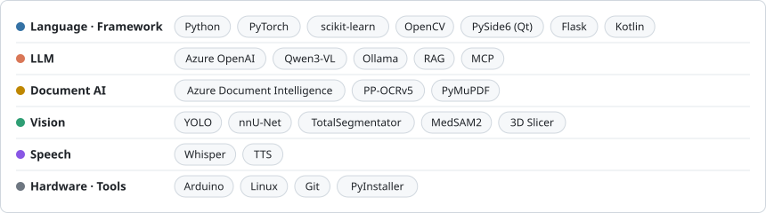

[한국어](README.md) · **English**

## Hyeokjin Shim

AI engineer · Document AI (LLM, OCR) · Computer vision · Medical imaging 
M.S. student, Information and Communication Engineering, Changwon National University (IISL), graduating Feb 2027

 

### At a glance

- **LG Electronics label drawing AI editor**: lead developer and PM. Used for drawings of ~30 countries; drawing load 10× faster (11.8 s → 1.2 s)
- **7 industry and contract projects**: LG Electronics (2), Samsung Changwon Hospital, Doosan, Hanwha Ocean, Taerim Industrial, KERI
- **5 first-author papers**: 1 KCI journal, 2 international conferences (ICTSS 2026 Springer, ICFICE 2025), 2 domestic conferences
- **Areas**: LLM/VLM applications, OCR and PDF processing, object detection, 3D medical imaging, speech recognition QA

### Tech stack

<picture>
  <source media="(prefers-color-scheme: dark)" srcset="assets/stack-dark.svg">
  
</picture>

### Projects

#### [[LG Electronics] Voice response verification](https://github.com/Hyeokzins/appliance-voice-verification) · 2026.03 – 2027.01, ongoing
Automatically judges whether a multi-dialect voice appliance answered correctly

- Role: Verification pipeline design, decision criteria experiments
- Result: Judges 500 scenarios (3 dialects) without a listener; criteria checked against 100 human-labeled cases
- Keywords: TTS · STT (Whisper) · LLM judge · Speech QA
- Paper: ICTSS 2026, KSMA 2026 Fall (first author)

#### [[LG Electronics] Label drawing AI editor](https://github.com/Hyeokzins/label-drawing-ai-editor) · 2025.12 – 2027.01, ongoing
Edits label PDFs from natural-language commands

- Role: Lead developer and PM: editor, server, manual/catalog comparison tool
- Result: Used for drawings of ~30 countries, 50+ releases. Drawing load 11.8 s → 1.2 s, OCR 4.4 s → 0.15 s
- Keywords: PDF graphics editing · LLM chat commands · VLM document analysis · OCR · Desktop app delivery

#### [[Samsung Changwon Hospital] Chest CT vessel diameter](https://github.com/Hyeokzins/ct-vessel-diameter) · 2025.07 – ongoing
Measures aortic and pulmonary artery diameters that physicians measured by hand

- Role: Landmark model design and training, data cleaning, measurement pipeline
- Result: Restructured the model so both endpoints fall on the same slice. Found 27 duplicate CT pairs and test-set leakage and rebuilt the splits
- Keywords: 3D landmark prediction · Medical image processing · Data QC
- Paper: SCI journal paper in preparation (first author)

#### [[Doosan] NDT room safety monitoring](https://github.com/Hyeokzins/ndt-room-safety-monitoring) · 2025.05 – 2025.12
Checks with CCTV that no one is inside before X-ray testing; installed on site

- Role: Detection model, door-open detection, Arduino circuit, installation and maintenance
- Result: Delivered model mAP@0.5 0.99 (our validation split). ~7,000 labeled frames, ~80 training runs
- Keywords: Object detection (YOLO) · Data labeling · Arduino circuit · Field installation

#### [[Hanwha Ocean] Dimension overlap repositioning](https://github.com/Hyeokzins/ship-drawing-dimension-layout) · 2025.04 – 2025.12
Finds overlapping dimension labels in ship drawings and suggests new positions

- Role: Repositioning algorithm, showcase talk
- Result: 35 of 38 overlapping labels (92%) placed best, 0.7–3.5 s per drawing
- Keywords: PDF drawing analysis · Line detection · Placement search

#### [[Taerim Industrial] Assembly defect prediction](https://github.com/Hyeokzins/assembly-defect-prediction) · 2023.03 – 2023.12
Predicts assembly defects from earlier process measurements; shop-floor GUI

- Role: Data cleaning and analysis, prediction model, GUI
- Result: Recall 0.99, F1 0.99 (8,747 production records, 8 models compared)
- Keywords: Data analysis (scikit-learn) · Defect prediction · Imbalanced data (SMOTE)
- Paper: JKIICE, KCI (first author)

#### [[KERI] Test room CCTV analysis and scheduling](https://github.com/Hyeokzins/test-room-cctv-scheduling) · 2023.01 – 2023.12
Recognizes worker activity and test readiness; optimizes test order

- Role: Worker activity and entry recognition, RL scheduling
- Result: Total test time cut by 11.8% (5 rooms, 25 tests), worker detection F1 98%
- Keywords: Object detection · Activity recognition · Reinforcement learning (Q-learning)
- Paper: ICFICE 2025 (first author)

Each title links to a showcase repo. Industry code is private, so the repos describe the problem, approach, and results.

### Teaching

#### [[LG Electronics] KAMP employee AI training](https://github.com/Hyeokzins/lg_kamp) · 2025.05 – 2025.07
AI training for LG Electronics kitchen appliance division employees (Kitchen AI Master Program, Changwon National University, ~7 weeks)

- Role: Lab materials for the local LLM, RAG, and MCP sessions; teaching assistant; taught one 1-hour session
- Labs: Local LLMs with Ollama, RAG over multiple PDFs, query expansion to 7 queries, mail and calendar agents with n8n and MCP
- Keywords: Local LLM · RAG · MCP · n8n · Lab materials

### More

- Hidden-text decoding mobile app (2024.06) - lab research, undergraduate capstone. Model conversion for mobile, auto region detection and decoding
- [Hospital waiting-count OCR](https://github.com/Hyeokzins/hz_project) (2023) - screen OCR and web posting. KICS 2025 Winter Conference

### Papers

- H. Shim, J. Shin, B. W. Kim, "Machine learning-based defect prediction model using pre-measured data in the assembly process of automotive steering components," *Journal of the Korea Institute of Information and Communication Engineering*, vol. 29, no. 6, pp. 833–843, 2025. [DOI](https://doi.org/10.6109/jkiice.2025.29.6.833)
- H. Shim, J. Je, B. W. Kim, "An end-to-end automated validation framework for multi-dialect voice recognition in home appliances using TTS, STT, and LLMs," ICTSS 2026 (poster, Springer proceedings, online late Nov 2026).
- H. Shim, B. W. Kim, "Reinforcement learning for efficient scheduling of test sequences in multi-room environments," ICFICE 2025, Guam, Jul. 2025 (poster).
- H. Shim, B. W. Kim, "Automated verification of appliance responses using weighted CER and STT transcription confidence," KSMA 2026 Fall (in Korean).
- H. Shim, H. Cho, B. W. Kim, "Software development of automatic recognition of hospital waiting patient numbers and web posting," KICS Winter Conference, 2025. [DBpia](https://www.dbpia.co.kr/journal/articleDetail?nodeId=NODE12132375)

### Notes

- [tech-record](https://github.com/Hyeokzins/tech-record): daily work log, May 2025 – present
