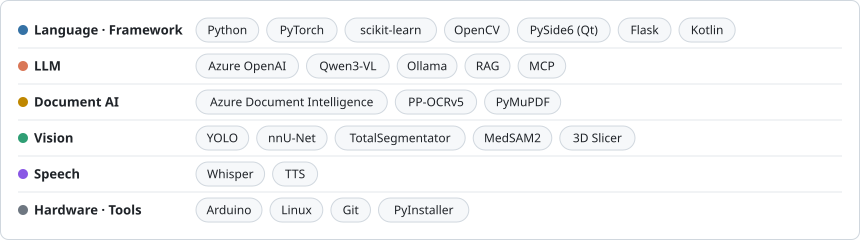

[English](README.md) · **한국어**

## 심혁진 (Hyeokjin Shim)

AI 엔지니어 · 문서 AI(LLM · OCR) · 컴퓨터 비전 · 의료영상
창원대학교 정보통신공학과 석사과정, IISL 연구실 (2027.02 졸업 예정)

 

### 한눈에 보기

- **LG전자 라벨 도면 AI 편집기** 기획·개발 총괄. 약 30개국 도면에 사용, 도면 열기 10배 빠르게 (11.8초 → 1.2초)
- **산학·위탁과제 7건**: LG전자 2 · 삼성창원병원 · 두산 · 한화오션 · 태림산업 · 한국전기연구원
- **1저자 논문 5편**: KCI 저널 1 · 국제학회 2 (ICTSS 2026 Springer, ICFICE 2025) · 국내학회 2
- **다뤄본 분야**: LLM·VLM 응용, OCR·PDF 처리, 객체 인식, 3D 의료영상, 음성 인식 검증

### 기술 스택

<picture>
  <source media="(prefers-color-scheme: dark)" srcset="assets/stack-dark.svg">
  
</picture>

### 산학 프로젝트

#### [[LG전자] 가전 음성 응답 자동 검증](https://github.com/Hyeokzins/appliance-voice-verification) · 26.03 – 27.01 진행 중
방언 음성 인식 가전의 응답이 맞는지 자동으로 판정

- 맡은 일: 검증 파이프라인 설계, 판정 기준 실험
- 성과: 시나리오 500건(방언 3종)을 사람 없이 판정, 사람 판정 100건과 기준 대조
- 키워드: TTS · STT (Whisper) · LLM 판정 · 음성 품질 검증
- 논문: ICTSS 2026, KSMA 2026 추계 (1저자)

#### [[LG전자] 라벨 도면 AI 편집기](https://github.com/Hyeokzins/label-drawing-ai-editor) · 25.12 – 27.01 진행 중
자연어 명령으로 라벨 PDF 도면을 고치는 프로그램

- 맡은 일: 기획·개발 총괄(PM). 편집기, 서버, 매뉴얼·카탈로그 비교 도구
- 성과: 약 30개국 도면에 사용, 패치 50회 이상. 도면 열기 11.8초 → 1.2초, OCR 4.4초 → 0.15초
- 키워드: PDF 그래픽 편집 · LLM 챗봇 명령 · VLM 문서 분석 · OCR · 데스크톱 앱 배포

#### [[삼성창원병원] 흉부 CT 혈관 직경 측정](https://github.com/Hyeokzins/ct-vessel-diameter) · 25.07 – 진행 중
의사가 손으로 재던 대동맥·폐동맥 직경을 자동으로 측정

- 맡은 일: 랜드마크 모델 설계·학습, 데이터 정제, 측정 파이프라인
- 성과: 두 끝점이 같은 슬라이스에 오도록 모델 구조 변경. 중복 CT 27쌍·테스트 누수를 찾아 데이터 재구성
- 키워드: 3D 랜드마크 예측 · 의료영상 처리 · 데이터 품질 점검
- 논문: SCI 저널 준비 중 (1저자)

#### [[두산] 비파괴검사실 안전 모니터링](https://github.com/Hyeokzins/ndt-room-safety-monitoring) · 25.05 – 25.12
방사선 검사 전 실내에 사람이 있는지 CCTV로 확인, 현장 설치

- 맡은 일: 객체 인식 모델 학습·개선, 문 열림 판정, 아두이노 회로 설계, 현장 설치·유지보수
- 성과: 납품 모델 mAP@0.5 0.99 (자체 검증셋). 라벨 약 7,000장, 학습 실험 약 80회
- 키워드: 객체 인식 (YOLO) · 데이터 라벨링 · 아두이노 회로 · 현장 설치

#### [[한화오션] 도면 치수 겹침 재배치](https://github.com/Hyeokzins/ship-drawing-dimension-layout) · 25.04 – 25.12
선박 도면에서 겹친 치수 글자를 찾아 새 위치 추천

- 맡은 일: 재배치 알고리즘 개발, 성과교류회 발표
- 성과: 겹친 글자 38개 중 35개(92%) 최적 배치, 도면 한 장 0.7~3.5초
- 키워드: PDF 도면 분석 · 영상처리 (선 검출) · 배치 탐색 알고리즘

#### [[태림산업] 조립 불량 예측](https://github.com/Hyeokzins/assembly-defect-prediction) · 23.03 – 23.12
앞 공정 측정값으로 조립 불량을 미리 예측, 현장용 GUI

- 맡은 일: 데이터 정제·분석, 예측 모델, GUI
- 성과: 재현율 0.99, F1 0.99 (생산 데이터 8,747건, 모델 8종 비교)
- 키워드: 데이터 분석 (scikit-learn) · 불량 예측 · 불균형 데이터 (SMOTE)
- 논문: 한국정보통신학회논문지, KCI (1저자)

#### [[한국전기연구원] 시험장 CCTV 분석·시험 스케줄링](https://github.com/Hyeokzins/test-room-cctv-scheduling) · 23.01 – 23.12
작업자 행동·시험 준비 상태 인식, 시험 순서 최적화

- 맡은 일: 작업자 행동·출입 인식, 강화학습 스케줄링
- 성과: 전체 시험 소요 시간 11.8% 단축 (시험실 5개·시험 25건), 작업자 검출 F1 98%
- 키워드: 객체 인식 · 행동 인식 · 강화학습 (Q-learning)
- 논문: ICFICE 2025 (1저자)

※ 제목을 누르면 프로젝트별 소개 저장소로 이동. 산학과제 코드는 비공개라 구조와 결과만 정리

### 교육

#### [[LG전자] KAMP 재직자 AI 교육](https://github.com/Hyeokzins/lg_kamp) · 25.05 – 25.07
LG전자 키친사업부 재직자 대상 AI 실무 교육 (Kitchen AI Master Program, 창원대 주관, 약 7주)

- 맡은 일: 로컬 LLM·RAG·MCP 실습 파트 자료 제작, 실습 조교, 1시간 세션 강의
- 실습 내용: Ollama로 로컬 LLM 구동, 여러 PDF를 읽는 RAG, 질문을 7개로 늘려 검색하는 쿼리 증강, n8n·MCP로 메일·캘린더 에이전트
- 키워드: 로컬 LLM · RAG · MCP · n8n · 실습 자료 제작

### 그 외 프로젝트

- 숨긴 정보 디코딩 모바일 앱 (24.06) - 연구실 연구, 학부 졸업 과제. 디코딩 모델 경량화, 카메라 화면 자동 검출·디코딩
- [병원 대기환자 수 OCR](https://github.com/Hyeokzins/hz_project) (23.07 - 23.12) - 화면 OCR, 웹 게시. 한국통신학회 2025 동계

### 논문

- [KCI] 자동차 조향부품 조립 공정에서 사전 측정 데이터를 활용한 머신러닝 기반 불량 예측 모델 | 한국정보통신학회논문지 29(6), 2025 | 1저자 | [DOI](https://doi.org/10.6109/jkiice.2025.29.6.833)
- [국제학회] An End-to-End Automated Validation Framework for Multi-Dialect Voice Recognition in Home Appliances Using TTS, STT, and LLMs | ICTSS 2026, Springer | 1저자 | 11월 말 게재 예정
- [국제학회] Reinforcement Learning for Efficient Scheduling of Test Sequences in Multi-Room Environments | ICFICE 2025, 괌 | 1저자
- [국내학회] 가중 CER과 STT 전사 신뢰도를 활용한 가전기기 응답 자동 검증 기법 | KSMA 2026 추계 | 1저자
- [국내학회] 병원 대기환자수 자동 인식 및 웹 게시 SW 개발 | 한국통신학회 2025 동계 | 1저자 | [DBpia](https://www.dbpia.co.kr/journal/articleDetail?nodeId=NODE12132375)

### 기록

- [tech-record](https://github.com/Hyeokzins/tech-record) - 일일 작업 기록 (25.05 -)
